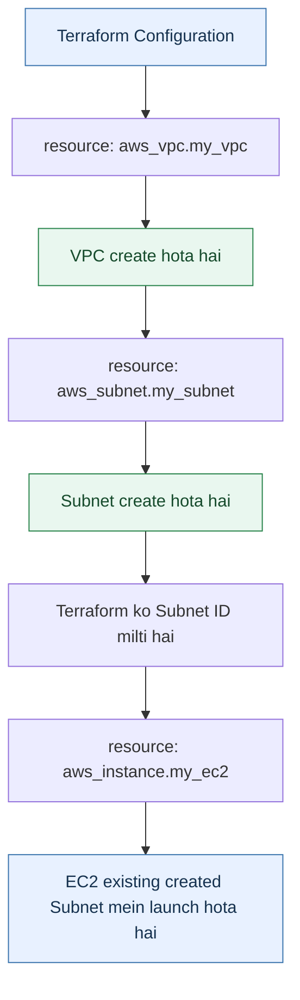
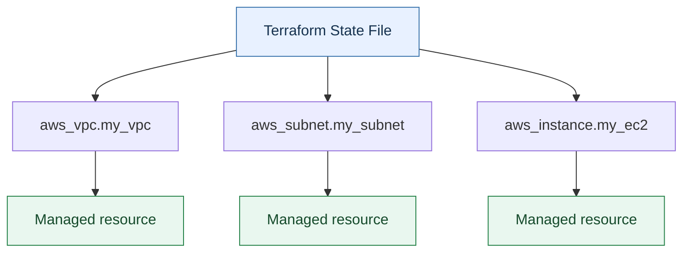
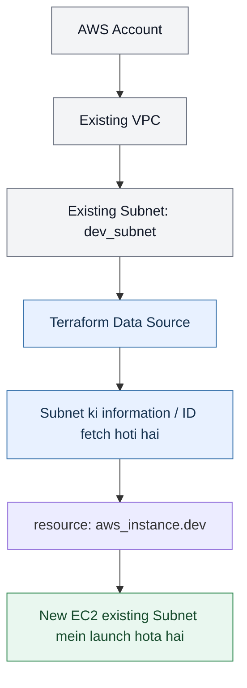
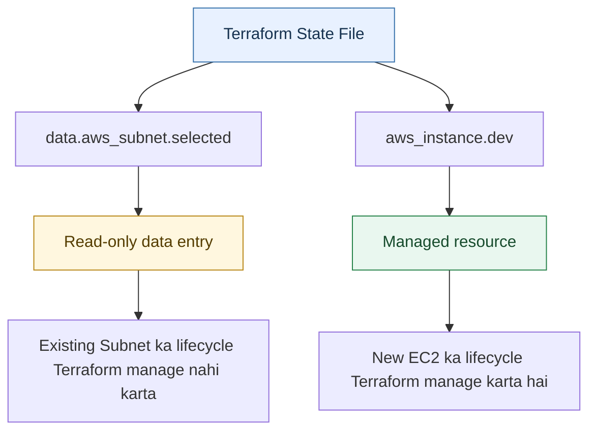
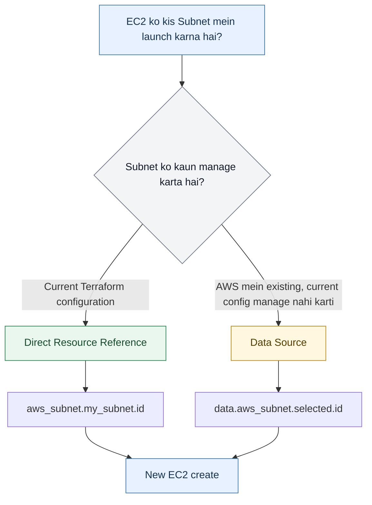

# Day 65 – Terraform Data Sources
## Existing VPC/Subnet: Data Source kab use karein aur kab nahi?

> **Main rule**
> - VPC/Subnet same Terraform configuration mein `resource` block se bana hai → direct reference use karo.
> - VPC/Subnet AWS mein pehle se hai aur current configuration usko manage nahi karti → information fetch karne ke liye Data Source use karo.

---

# 1. Pehle basic concept samjho

| Block | Simple meaning | Terraform ka kaam |
|---|---|---|
| `resource` | Naya resource banana / manage karna | Create, update, delete (configuration ke hisaab se) |
| `data` | Existing resource ki information read karna | Sirf information fetch karna |

**Example:** AWS mein ek Subnet already bana hua hai. Terraform ko us Subnet ki ID chahiye, taaki woh usi Subnet mein EC2 launch kar sake. Is kaam ke liye Data Source useful hai.

---

# 2. Case 1 – VPC aur Subnet Terraform se banaye hain

Maan lo ek hi Terraform configuration mein hum VPC, Subnet aur EC2 create kar rahe hain.

## Flow diagram



**Is case mein Data Source ki zarurat nahi hai.** Terraform ne khud VPC aur Subnet banaye hain, isliye unki IDs ko direct reference kar sakte hain.

## Step 1 – VPC create karo

```hcl
resource "aws_vpc" "my_vpc" {
  cidr_block = "10.0.0.0/16"

  tags = {
    Name = "my-vpc"
  }
}
```

## Step 2 – VPC ke andar Subnet create karo

```hcl
resource "aws_subnet" "my_subnet" {
  vpc_id     = aws_vpc.my_vpc.id
  cidr_block = "10.0.1.0/24"

  tags = {
    Name = "my-subnet"
  }
}
```

## Step 3 – Usi Subnet mein EC2 create karo

```hcl
resource "aws_instance" "my_ec2" {
  ami           = "ami-xxxxxxxx"
  instance_type = "t2.micro"

  subnet_id = aws_subnet.my_subnet.id
}
```

### Important line

```hcl
subnet_id = aws_subnet.my_subnet.id
```

Iska matlab: `my_subnet` naam ke Terraform resource se Subnet ID lo aur EC2 mein use karo.

Terraform dependency samajh lega: pehle VPC, phir Subnet, phir EC2.

## State File mein kya hoga?



| Resource | State File mein? | Terraform lifecycle manage karega? |
|---|---|---|
| VPC (`aws_vpc.my_vpc`) | Yes | Yes |
| Subnet (`aws_subnet.my_subnet`) | Yes | Yes |
| EC2 (`aws_instance.my_ec2`) | Yes | Yes |

**Conclusion:** Same Terraform configuration mein managed resource ki ID lene ke liye direct reference use karo. Data Source normally required nahi hai.

---

# 3. Case 2 – VPC aur Subnet AWS mein pehle se existing hain

Ab maan lo:

- VPC AWS Console se manually create kiya gaya tha.
- Us VPC ke andar Subnet bhi pehle se bana hua hai.
- Current Terraform configuration in VPC/Subnet ko manage nahi karti.
- Hume existing Subnet mein ek naya EC2 launch karna hai.

## Flow diagram



**Is case mein Data Source useful hai**, kyunki Terraform ko AWS mein pehle se maujood Subnet ki ID find karni hai.

## Step 1 – Existing Subnet ki information fetch karo

Maan lo Subnet ka Name tag `dev_subnet` hai.

```hcl
data "aws_subnet" "selected" {
  filter {
    name   = "tag:Name"
    values = ["dev_subnet"]
  }
}
```

Simple meaning:

- `data` = Existing resource ki information read karo.
- `aws_subnet` = AWS Subnet ki information chahiye.
- `selected` = Data Source ka local naam.
- `filter` = Kis condition se Subnet search karna hai.
- `tag:Name` = Subnet ke Name tag ke basis par search.
- `dev_subnet` = Required Subnet ka tag value.

## Step 2 – Fetched Subnet ID ko EC2 mein use karo

```hcl
resource "aws_instance" "dev" {
  ami           = "ami-xxxxxxxx"
  instance_type = "t2.micro"

  subnet_id = data.aws_subnet.selected.id
}
```

### Important line

```hcl
subnet_id = data.aws_subnet.selected.id
```

Iska matlab: Data Source se jo existing Subnet ID mili hai, usi ID ko EC2 launch karne ke liye use karo.

> Note: AWS provider configuration, valid AMI aur required permissions bhi configured hone chahiye. `aws_subnet` singular data source ko exactly ek matching Subnet milna chahiye. Multiple matches hone par error aa sakta hai.

## State File mein kya hoga?



| Item | State File mein? | Terraform lifecycle manage karega? |
|---|---|---|
| Existing VPC (agar read hi nahi kiya) | Is configuration mein entry nahi | No |
| Existing Subnet (Data Source se read kiya) | Yes, data entry | No |
| New EC2 (`resource` block) | Yes, managed resource | Yes |

**Important:** Data Source ki information State File mein record hoti hai, lekin iska matlab yeh nahi ki Terraform existing Subnet ko own ya manage karne laga.

---

# 4. Dono cases ka side-by-side flow



| Point | Case 1: Terraform-created | Case 2: Already existing |
|---|---|---|
| VPC/Subnet kisne banaya? | Current Terraform configuration | Pehle se AWS mein |
| EC2 ko ID kaise milegi? | Direct resource reference | Data Source |
| Example | `aws_subnet.my_subnet.id` | `data.aws_subnet.selected.id` |
| Data Source required? | Normally no | Useful |
| Existing VPC/Subnet ka lifecycle | Terraform manage karta hai | Current configuration manage nahi karti |

---

# 5. Direct Reference vs Data Source – syntax yaad rakho

**Direct resource reference**

```hcl
subnet_id = aws_subnet.my_subnet.id
```

Use when Subnet ko current Terraform configuration mein `resource` block se manage kiya ja raha hai.

**Data Source reference**

```hcl
subnet_id = data.aws_subnet.selected.id
```

Use when existing Subnet ki information `data` block se read ki ja rahi hai.

- `aws_subnet.my_subnet.id` → Resource reference.
- `data.aws_subnet.selected.id` → Data Source reference.

---

# 6. Data Source vs Import

| Data Source | Import |
|---|---|
| Existing resource ki information read karta hai | Existing resource ko Terraform management mein laane ke liye use hota hai |
| Read-only data entry State mein record hoti hai | Resource managed resource ke roop mein State mein register hota hai |
| Lifecycle manage nahi karta | Import ke baad configuration likhkar lifecycle manage kar sakte ho |

**Important:** Import se pehle matching Terraform `resource` configuration likhni hoti hai. Import khud se complete desired configuration generate nahi karta.

---

# 7. Interview Questions

**Q1. What is a Terraform Data Source?**

A Data Source allows Terraform to read information about an existing resource without managing its lifecycle.

**Q2. If VPC and Subnet are created in the same Terraform configuration, do we need a Data Source to create EC2?**

No. We can directly reference the Subnet ID using `aws_subnet.my_subnet.id`.

**Q3. When do we use a Data Source?**

We use a Data Source when we need to fetch information about an existing resource that is not managed by the current Terraform configuration.

**Q4. Does a Data Source get stored in the Terraform State file?**

Yes. Terraform records the fetched Data Source information in the State file as a read-only data entry. It does not manage the lifecycle of the actual existing resource.

---

# 8. Final revision – one-minute recap

```text
CASE 1
VPC Terraform se create
          |
          v
Subnet Terraform se create
          |
          v
Direct reference: aws_subnet.my_subnet.id
          |
          v
EC2 create
          |
          v
Data Source normally NOT needed


CASE 2
VPC/Subnet AWS mein pehle se existing
          |
          v
Data Source se Subnet information fetch
          |
          v
Reference: data.aws_subnet.selected.id
          |
          v
EC2 create
          |
          v
Data Source useful
```

## Golden Rule

**Same Terraform configuration ka managed resource → Direct Reference**

**Existing resource jo current configuration manage nahi karti → Data Source se information fetch**

Yahi Day 65 ke Data Sources concept ka main difference hai.
