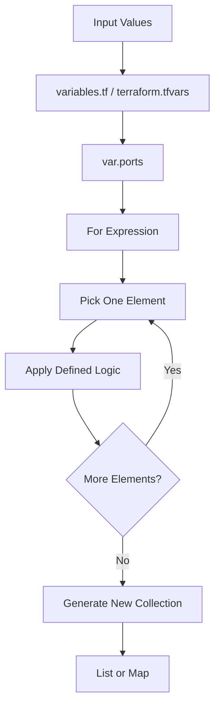
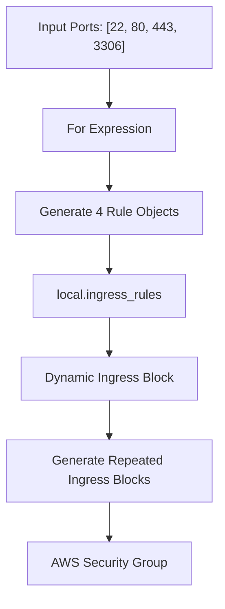

# Day – Terraform For Expression

# 1. What is For Expression?

Terraform **For Expression** ka use kisi existing collection (List, Set ya Map) ke elements ko one-by-one iterate karke ek new List ya Map generate karne ke liye hota hai.

### Simple Explanation

Hum Terraform ko ek input collection dete hain. Terraform us collection ke elements ko one-by-one read karta hai aur hamare defined logic ke according new collection generate karta hai.

### Example

**Input:**

```hcl
ports = [22, 80, 443, 3306]
```

**For Expression:**

```hcl
[for port in var.ports : "Allow port ${port}"]
```

**Output:**

```hcl
[
  "Allow port 22",
  "Allow port 80",
  "Allow port 443",
  "Allow port 3306"
]
```

Yaani ek input List se Terraform ne new List generate kar di.

---

# 2. Why do we use For Expression?

Maan lo hume AWS Security Group mein 4 inbound ports allow karne hain.

| Port | Purpose |
|---|---|
| 22 | SSH |
| 80 | HTTP |
| 443 | HTTPS |
| 3306 | MySQL |

Without For Expression, hume har port ke liye similar configuration manually repeat karni pad sakti hai.

Agar 50 ports hain, toh 50 baar similar code likhna difficult ho jayega.

### Benefits

1. Repetitive code reduce karta hai.
2. Collection ke elements ko automatically iterate karta hai.
3. New List ya Map generate kar sakta hai.
4. Code ko maintain karna easy banata hai.
5. Dynamic configurations prepare karne mein help karta hai.

---

# 3. For Expression Syntax

For Expression ke 2 common forms hain:

### A. List Expression

```hcl
[for item in collection : result]
```

Square brackets `[ ]` ka use hota hai.

### B. Map Expression

```hcl
{for item in collection : key => value}
```

Curly brackets `{ }` ka use hota hai.

### Syntax Explanation

| Keyword | Meaning |
|---|---|
| `[ ]` | List generate karta hai |
| `{ }` | Map/Object generate karta hai |
| `for` | Iteration start karta hai |
| `item` | Current element ka temporary name |
| `in` | Collection se element read karna |
| `collection` | Original List, Set ya Map |
| `:` | Output expression start karta hai |
| `result` | Har element ke liye output |
| `=>` | Map ki Key aur Value ko separate karta hai |

**Important:** `item` koi reserved Terraform keyword nahi hai. Hum apni choice se naam rakh sakte hain, jaise `port`, `number`, `x` etc.

---

# 4. Input Values Kahan Provide Karte Hain?

For Expression khud se input values generate nahi karta. Usko ek existing collection chahiye hoti hai.

Input values provide karne ke common methods:

### Method 1 – variables.tf

```hcl
variable "ports" {
  description = "List of allowed ports"
  type        = list(number)
  default     = [22, 80, 443, 3306]
}
```

Yahan humne `ports` naam ka variable declare kiya aur default values provide ki hain.

### Method 2 – terraform.tfvars

```hcl
ports = [22, 80, 443, 3306]
```

Is method mein variable ki values alag file mein provide karte hain.

### Method 3 – Command Line

```bash
terraform apply -var='ports=[22,80,443,3306]'
```

### Other Possible Input Sources

- Variables
- Data Sources
- Resource Attributes
- Module Outputs
- Directly written collection values

### Variable ko Access Kaise Karen?

```hcl
var.ports
```

`var.ports` ka matlab hai `ports` naam ke variable ki value access karna.

**Remember:** `variables.tf` mein variable declare karte hain, `terraform.tfvars` mein input values de sakte hain aur `main.tf` mein `var.ports` se un values ko use karte hain.

---

# 5. Complete Working Flow



### Flow Explanation

1. variables.tf ya terraform.tfvars mein input values dete hain.
2. main.tf mein `var.ports` se values access karte hain.
3. For Expression ek-ek element pick karta hai.
4. Har element par defined operation perform hota hai.
5. Sabhi results ko collect karke new List ya Map generate hoti hai.

---

# 6. Example 1 – For Expression to Generate a List

### Input

```hcl
variable "ports" {
  type    = list(number)
  default = [22, 80, 443, 3306]
}
```

### main.tf

```hcl
output "allowed_ports" {
  value = [for port in var.ports : port]
}
```

### Output

```hcl
[
  22,
  80,
  443,
  3306
]
```

### Explanation

```hcl
[for port in var.ports : port]
```

- `for` = Loop start.
- `port` = Current element.
- `var.ports` = Input collection.
- `: port` = Current port ko output mein return karo.
- `[ ]` = New List generate karo.

### Iteration Flow

```text
Input: [22, 80, 443, 3306]

Iteration 1 → port = 22
Iteration 2 → port = 80
Iteration 3 → port = 443
Iteration 4 → port = 3306

Output: [22, 80, 443, 3306]
```

---

# 7. Example 2 – For Expression to Generate a Map

### Input

```hcl
variable "ports" {
  type    = list(number)
  default = [22, 80, 443]
}
```

### For Expression

```hcl
output "port_description" {
  value = {
    for port in var.ports :
    tostring(port) => "Allow port ${port}"
  }
}
```

### Output

```hcl
{
  "22"  = "Allow port 22"
  "80"  = "Allow port 80"
  "443" = "Allow port 443"
}
```

### Explanation

- `tostring(port)` = Port ko String mein convert karta hai.
- `=>` = Key aur Value ko separate karta hai.
- `"Allow port ${port}"` = Value generate karta hai.
- `{ }` = Map/Object collection generate karta hai.

### List vs Map

| List | Map |
|---|---|
| Square brackets `[ ]` | Curly brackets `{ }` |
| Elements store karti hai | Key-Value pairs store karti hai |
| `[22, 80, 443]` | `{"22" = "SSH", "80" = "HTTP"}` |

---

# 8. Practical Example – Security Group with For Expression

### Scenario

Hume AWS Security Group mein multiple inbound rules configure karne hain.

Ports:

```hcl
[22, 80, 443, 3306]
```

Hum har port ke liye manually rule repeat nahi karna chahte.

Isliye:

1. For Expression se rule objects ki List generate karenge.
2. Dynamic Block se repeated ingress blocks generate karenge.

### Step 1 – variables.tf

```hcl
variable "ports" {
  description = "List of allowed ports"
  type        = list(number)
  default     = [22, 80, 443, 3306]
}
```

### Step 2 – main.tf

```hcl
locals {
  ingress_rules = [
    for port in var.ports : {
      description = "Allow port ${port}"
      from_port   = port
      to_port     = port
      protocol    = "tcp"
      cidr_blocks = ["10.0.0.0/16"]
    }
  ]
}

resource "aws_security_group" "websg" {

  name   = "my-security-group"
  vpc_id = aws_vpc.main.id

  dynamic "ingress" {
    for_each = local.ingress_rules

    content {
      description = ingress.value.description
      from_port   = ingress.value.from_port
      to_port     = ingress.value.to_port
      protocol    = ingress.value.protocol
      cidr_blocks = ingress.value.cidr_blocks
    }
  }
}
```

**Note:** Is example mein `aws_vpc.main.id` assume kiya gaya hai ki VPC resource separately defined hai.

### Step 3 – Code ka Working

**A. Input Values**

```hcl
default = [22, 80, 443, 3306]
```

Humne 4 ports provide kiye.

**B. For Expression**

```hcl
ingress_rules = [
  for port in var.ports : {
    from_port = port
    to_port   = port
  }
]
```

Terraform har port ke liye ek rule object generate karta hai.

Conceptually output:

```hcl
[
  {
    from_port = 22
    to_port   = 22
  },
  {
    from_port = 80
    to_port   = 80
  },
  {
    from_port = 443
    to_port   = 443
  },
  {
    from_port = 3306
    to_port   = 3306
  }
]
```

Ye objects `local.ingress_rules` mein store hote hain.

**C. Dynamic Block**

```hcl
dynamic "ingress" {
  for_each = local.ingress_rules
```

Dynamic Block generated objects ko one-by-one iterate karke repeated ingress configuration blocks generate karta hai.

**D. Content**

```hcl
content {
  from_port = ingress.value.from_port
  to_port   = ingress.value.to_port
}
```

Har generated object ki values ingress block mein use hoti hain.

### Complete Practical Flow



### Security Note

`10.0.0.0/16` example VPC CIDR hai.

`0.0.0.0/0` ka matlab all IPv4 addresses se access allow karna hai.

Production mein SSH (22) aur MySQL (3306) jaise sensitive ports ko publicly open avoid karna chahiye.

---

# 9. For Expression vs Dynamic Block

Dono repetition reduce karte hain, lekin dono ka purpose alag hai.

| For Expression | Dynamic Block |
|---|---|
| New List ya Map generate karta hai | Repeated nested blocks generate karta hai |
| Collection transformation ke liye | Nested resource configuration ke liye |
| Data ko transform karta hai | Configuration blocks generate karta hai |
| Example: `[for port in var.ports : port]` | Example: `dynamic "ingress"` |

### Easy Way to Remember

**For Expression = Collection generate karna.**

**Dynamic Block = Repeated nested configuration blocks generate karna.**

Dono ko ek saath use kar sakte hain.

---

# 10. Important Points to Remember

1. For Expression input collection ke bina kaam nahi karta.
2. Input values variables, tfvars, data sources ya other expressions se aa sakti hain.
3. `var.ports` variable ko access karta hai.
4. `port` current iteration ka temporary variable hai.
5. Square brackets `[ ]` se List expression banta hai.
6. Curly brackets `{ }` se Map/Object expression banta hai.
7. `=>` Map mein Key aur Value separate karta hai.
8. For Expression khud AWS resources create nahi karta.
9. For Expression collection values generate ya transform karta hai.
10. Dynamic Block repeated nested configuration blocks generate kar sakta hai.

---

# 11. Interview Questions and Answers

### Q1. What is Terraform For Expression?

A Terraform For Expression is used to iterate over elements of a collection, such as a list, set, or map, and transform them into a new list or map.

### Q2. Why do we use For Expression?

We use For Expressions to reduce repetitive code, transform collections, and create dynamic configurations.

### Q3. What is the difference between List and Map in For Expression?

A List stores a sequence of elements, whereas a Map stores key-value pairs.

### Q4. What does `port` represent in `for port in var.ports`?

`port` is a temporary variable representing the current element during each iteration.

### Q5. Does For Expression create AWS resources?

No. For Expression transforms collection data. AWS resources are created by resource blocks.

### Q6. What is the difference between For Expression and Dynamic Block?

For Expression generates a new collection, whereas Dynamic Blocks generate repeated nested configuration blocks.

### Q7. Where do we provide input values for For Expression?

Input values can be provided through variables, terraform.tfvars, data sources, resource attributes, module outputs, or directly written collections.

---

# 12. Final Revision Flow

```text
INPUT COLLECTION
      |
      v
variables.tf / terraform.tfvars
      |
      v
var.ports
      |
      v
FOR EXPRESSION
      |
      v
ONE-BY-ONE ITERATION
      |
      v
APPLY DEFINED LOGIC
      |
      v
GENERATE NEW LIST / MAP
      |
      v
USE GENERATED COLLECTION
```

### Interview One-Line Summary

Terraform For Expression iterates over an existing collection and transforms its elements into a new list or map, helping reduce repetitive code and simplify configuration management.


Ye raha tumhara same explanation, properly formatted `.md` notes mein. VS Code mein `Terraform-List-Map-For-Expression.md` naam se save kar sakte ho.

# Terraform – List, Map & For Expression

## 1. List kya hoti hai?

Socho tumhare paas 3 ports hain:

```
allowed_ports = [22, 80, 443]
```

Yahan sirf values hain. Koi naam nahi diya hai.

- 22 = SSH
- 80 = HTTP
- 443 = HTTPS

Isko **List** kehte hain.

## 2. Map kya hota hai?

Ab wahi ports naam ke saath likho:

```
allowed_ports = {
  ssh   = 22
  http  = 80
  https = 443
}
```

Yahan har port ke saath ek naam bhi hai.

- `ssh` naam hai, `22` value hai.
- `http` naam hai, `80` value hai.
- `https` naam hai, `443` value hai.

Isko **Map** kehte hain.

## 3. Ab Terraform ki 3 files samjho

Dono examples mein 3 files ka kaam same hai:

| File               | Kaam                            |
| ------------------ | ------------------------------- |
| `variables.tf`     | Batati hai data List hai ya Map |
| `terraform.tfvars` | Actual data rakhti hai          |
| `main.tf`          | Data ko use karti hai           |

### List ke case mein

**variables.tf**

```
variable "allowed_ports" {
  type = list(number)
}
```

**terraform.tfvars**

```
allowed_ports = [22, 80, 443]
```

### Map ke case mein

**variables.tf**

```
variable "allowed_ports" {
  type = map(number)
}
```

**terraform.tfvars**

```
allowed_ports = {
  ssh  = 22
  http = 80
}
```

## 4. Ab For Expression samjho

### List mein

```
[
  for port in var.allowed_ports : port
]
```

Iska simple meaning:

- `var.allowed_ports` = Hamari List.
- `for port` = List se ek-ek port uthao.
- `: port` = Usi port ko naye result mein daal do.

### Map mein

```
{
  for name, port in var.allowed_ports :
  name => port
}
```

Iska meaning:

- `name` = Key, jaise `ssh`.
- `port` = Value, jaise `22`.
- `name => port` = Key aur Value ko naye Map mein daal do.

## 5. Bas ye 2 baatein yaad rakho

- **List** = Sirf values `[22, 80, 443]`
- **Map** = Naam ke saath values `{ssh = 22, http = 80}`

Abhi For Expression ka main purpose hai:

**Collection ke andar se ek-ek item nikalna aur usse naya result banana.**