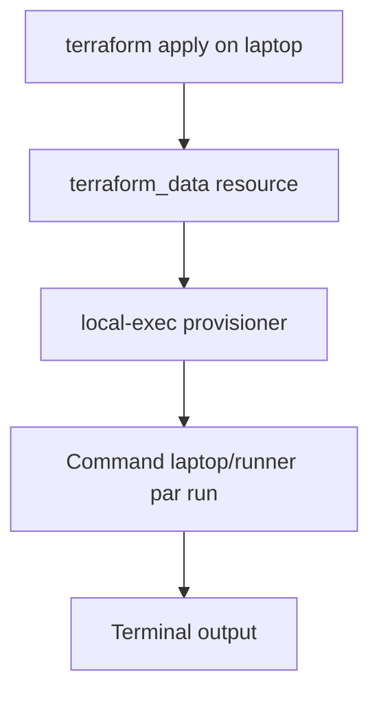
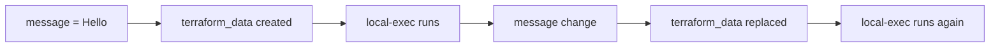

# Lab 01 – local-exec

## Goal
Terraform chalane wali machine par command run karna. Is lab mein AWS/EC2 create nahi hota.

## Concept in simple Hinglish
Maan lo tum apne Windows laptop/CI runner par `terraform apply` chalate ho. `local-exec` ka command bhi usi machine par execute hota hai. Ye command EC2 ke andar nahi jaata.



## Files
- `main.tf`: Terraform resource + local-exec.
- `scripts/local-setup.sh`: Optional local shell script.
- `terraform.tfvars.example`: Sample input values.

## Run (Git Bash / Linux / macOS)
```bash
cp terraform.tfvars.example terraform.tfvars
terraform init
terraform fmt
terraform validate
terraform apply
```

`yes` type karke confirm karo. Terminal mein message print hoga.

## Script execute karna
`terraform.tfvars` mein:
```hcl
message    = "Script practice"
run_script = true
```
Then:
```bash
terraform apply
```
Git Bash/Linux/macOS par Bash available hona chahiye. Windows PowerShell-only environment mein script command ko suitable PowerShell script/command se replace karo.

## Repeat trigger kaise hota hai?
`triggers_replace` mein `message` aur `run_script` hain. In values ko change karne par `terraform_data` replace hoga aur creation-time provisioner phir run hoga.



## Windows popup
`main.tf` mein commented PowerShell block example hai. Use uncomment karne par inline command ki jagah PowerShell popup command use karo. Popup sirf interactive Windows desktop session mein dikhega; headless CI/CD runner mein nahi.

## Real-world uses
- Local script trigger karna.
- Build/test command run karna.
- Local log/notification generate karna.
- Local automation call karna.

## Interview point
`local-exec` runs a command on the machine where Terraform is executed, not on the provisioned EC2 instance.

## Cleanup
```bash
terraform destroy
```
