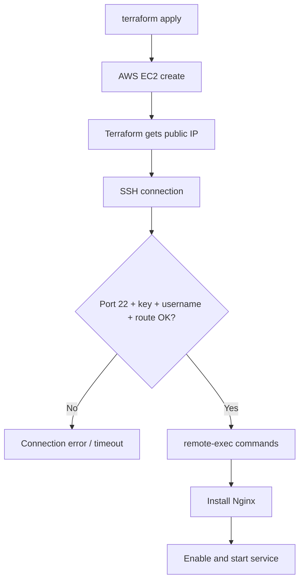

# Lab 02 – remote-exec

## Goal
EC2 create karna aur SSH ke through EC2 ke andar Nginx install/start karna.

## Concept
`remote-exec` ka command Terraform laptop par nahi, remote EC2 par execute hota hai. Terraform SSH connection establish karta hai aur phir commands bhejta hai.



## Prerequisites
- AWS credentials configured (`aws configure` or environment/role).
- Default VPC exists in chosen region.
- Existing EC2 key pair exists in the same region.
- Matching private key file is on your machine.
- Your public IP CIDR is correct (`x.x.x.x/32`).

## Configure
```bash
cp terraform.tfvars.example terraform.tfvars
```
Edit `terraform.tfvars`. Never share/commit the private key or actual tfvars file.

## Run
```bash
terraform init
terraform fmt
terraform validate
terraform plan
terraform apply
```

After apply, Terraform prints the EC2 public IP. The remote-exec provisioner installs Nginx.

## Verify
```bash
ssh -i "C:/path/to/key.pem" ec2-user@PUBLIC_IP
sudo systemctl status nginx
```

## Connection checklist
| Check | Why |
|---|---|
| EC2 public IP | Terraform must reach the instance |
| SG inbound TCP 22 | SSH traffic must be allowed |
| CIDR | Must match current public IP |
| Private key | Must match selected EC2 key pair |
| Username | Amazon Linux uses `ec2-user` |
| Network | Internet route and public IP required |

## Important
- Provisioner runs during instance creation. It does not automatically run on every `terraform apply`.
- SSH failures can make resource creation fail.
- Do not use `0.0.0.0/0` for SSH in normal practice.

## Cleanup
```bash
terraform destroy
```
