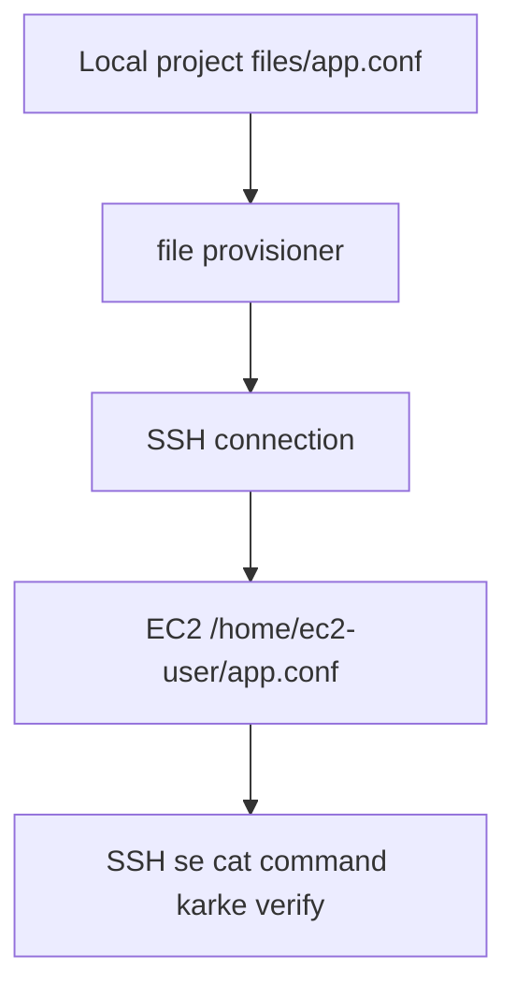

# Lab 03 – file provisioner

## Goal
Laptop ki local file ko EC2 ke folder mein copy karna.

## Concept
`file` provisioner local source file ko remote destination par transfer karta hai. Ye file ko execute nahi karta.



## Source vs destination
- `source`: Terraform machine par file ka path.
- `destination`: EC2 par file ka path.
- `connection`: remote machine tak pahunchne ke SSH details.

## Run
```bash
cp terraform.tfvars.example terraform.tfvars
# Edit terraform.tfvars with your AWS key pair, private key path and public IP CIDR
terraform init
terraform fmt
terraform validate
terraform plan
terraform apply
```

## Verify
```bash
ssh -i "C:/path/to/key.pem" ec2-user@PUBLIC_IP
cat /home/ec2-user/app.conf
```

## Remember
`file` provisioner = transfer. Command chalani ho to `remote-exec` use hota hai. Remote destination folder aur permissions correct hone chahiye.

## Cleanup
```bash
terraform destroy
```
