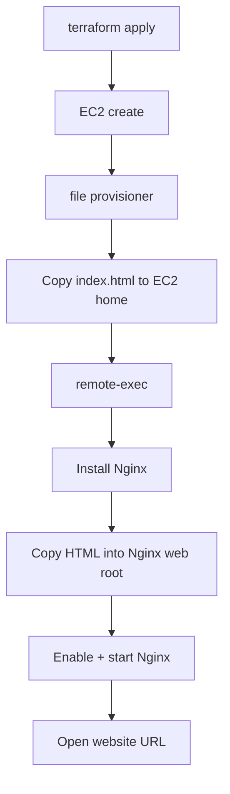

# Lab 04 – Combined Practice

## Goal
Ek hi EC2 par pehle local HTML file copy karna, phir remote commands se Nginx setup karna.

## Execution flow



## Provisioner order
Terraform mein is resource ke andar file provisioner pehle likha hai, remote-exec baad mein. Creation-time provisioners run in configuration order.

## Configure and run
```bash
cp terraform.tfvars.example terraform.tfvars
# Fill the values carefully
terraform init
terraform fmt
terraform validate
terraform plan
terraform apply
```

Output `website_url` ko browser mein open karo. HTTP inbound CIDR `http_allowed_cidr` se controlled hai. Safer practice: apna public IP `/32` use karo. `0.0.0.0/0` sirf tab use karo jab tum intentionally public demo website expose karna chahte ho.

## Verify
```bash
ssh -i "C:/path/to/key.pem" ec2-user@PUBLIC_IP
sudo systemctl status nginx
```

## Cleanup
```bash
terraform destroy
```

**Cost/security:** Real EC2 create hota hai. Public HTTP exposure avoid karo unless required. Practice ke baad destroy karo.
