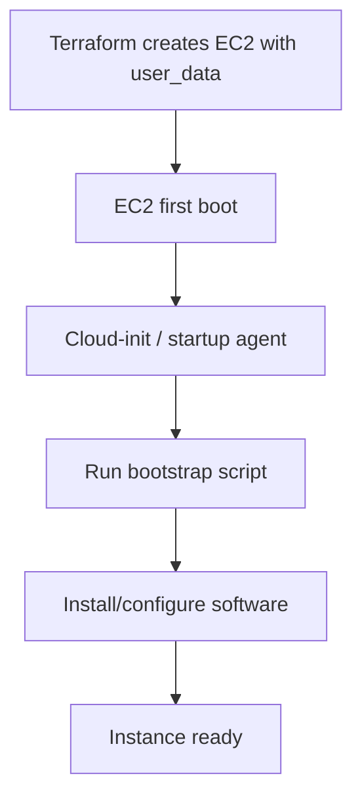
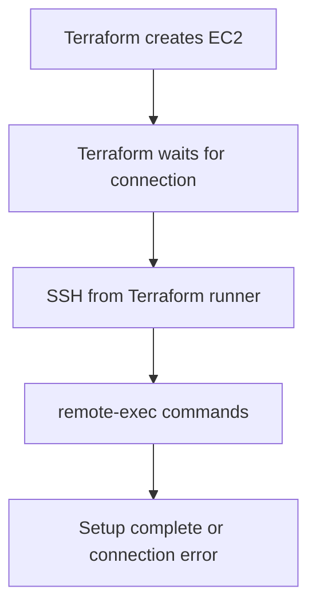
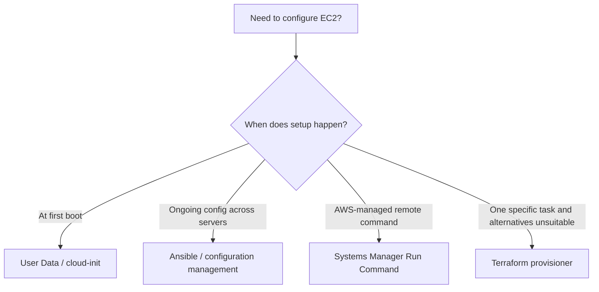

# User Data vs Provisioners – Decision Guide

## Core difference

**User Data:** EC2 first boot/launch initialization ke liye startup script provide karta hai. AWS/guest OS startup mechanism script execute karta hai.

**Provisioner:** Terraform resource lifecycle ke dauran extra action execute karne ki koshish karta hai, e.g. SSH se remote command ya file transfer.

## User Data flow

## remote-exec flow

## Comparison

| Point | User Data | Provisioner remote-exec |
|---|---|---|
| Runs through | EC2 startup/cloud-init | Terraform connection (often SSH) |
| SSH needed from Terraform? | No | Usually yes |
| Main use | Initial bootstrap | Specific remote action |
| Trigger | Instance boot/cloud-init behavior | Resource lifecycle event |
| Every apply? | No, not by default | No |
| Failure/debugging | Instance logs/cloud-init | Terraform output + SSH logs |

## Why provisioners are last resort

1. Terraform must reach the remote host.
2. SSH key, username, port, routing and firewall must all be correct.
3. A command can fail after infrastructure has already been created.
4. Terraform does not continuously manage the software configuration.
5. Re-running provisioners predictably can require replacement or extra trigger resources.

## Choose the right tool

## Interview answer

Terraform provisioners are used to execute additional actions during resource creation or destruction. `local-exec` runs on the Terraform runner, `remote-exec` runs commands on a remote machine, and `file` transfers files. They are considered a last resort because they introduce external dependencies such as network connectivity, SSH credentials and command execution, and they do not provide continuous configuration management. For initial EC2 bootstrap, User Data or cloud-init is usually preferred.
