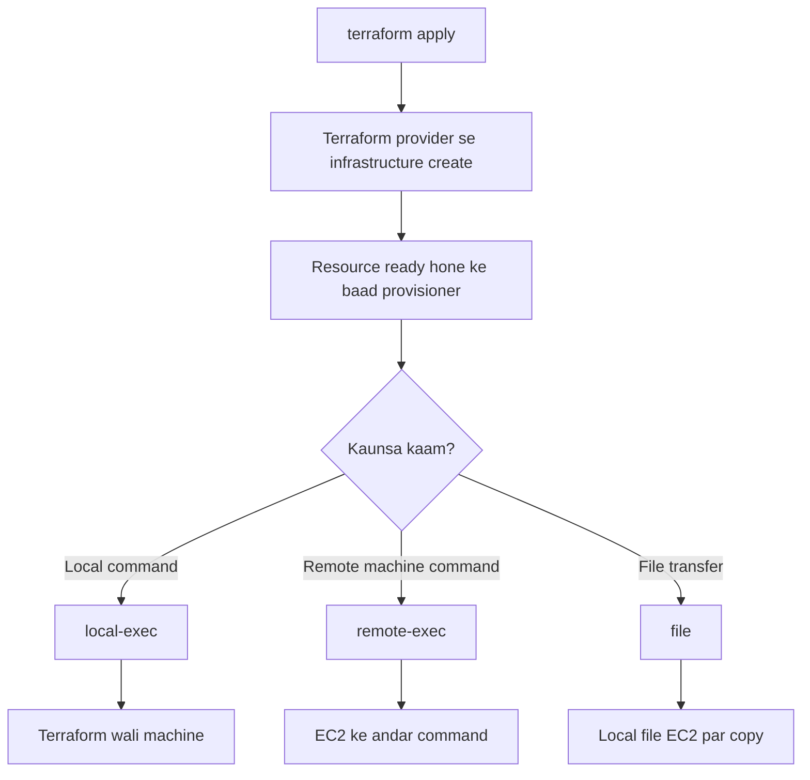
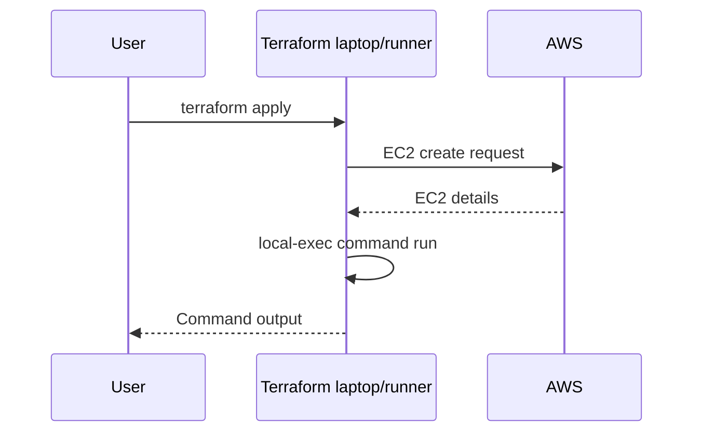
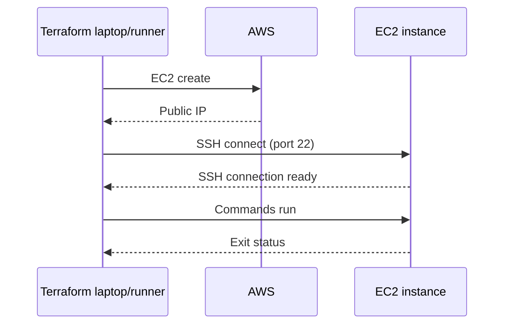
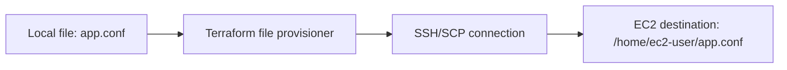
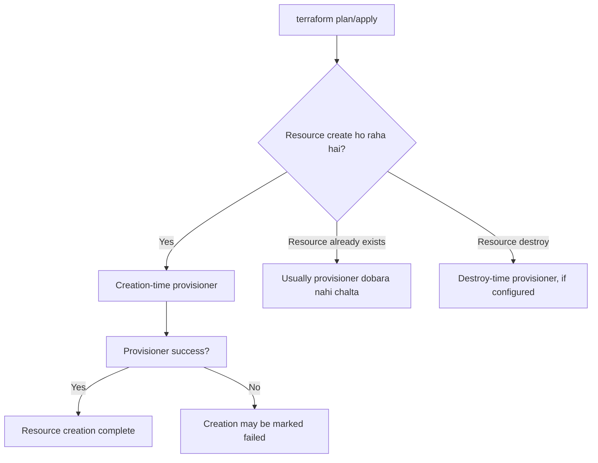
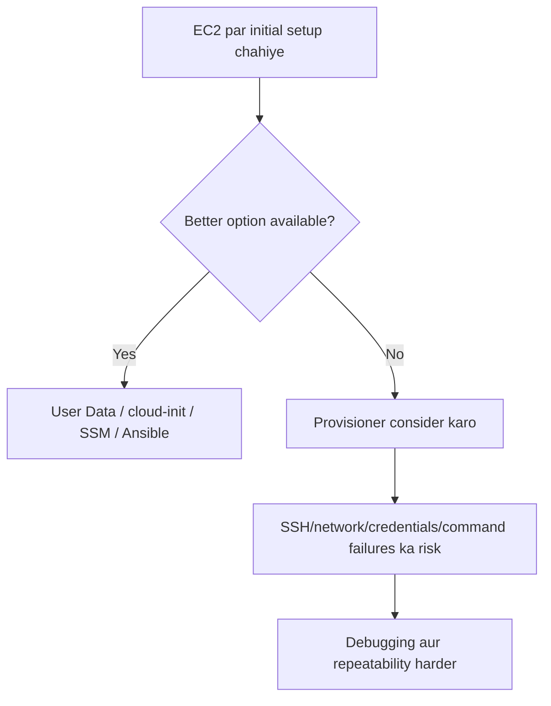
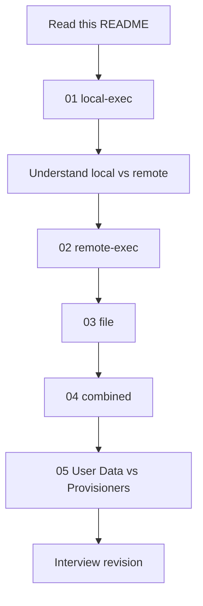

# Terraform Provisioners – Complete Practical Mastery

> Beginner-friendly Hinglish notes + practical Terraform labs + Mermaid flow diagrams.

## 1. Sabse pehle: Provisioner kya karta hai?

Terraform ka primary kaam **infrastructure create, update aur destroy** karna hai.
Example: VPC, subnet, security group, EC2.

Kabhi-kabhi infrastructure create hone ke baad humein extra action chahiye:
- Terraform chalane wali machine par command run karna.
- EC2 ke andar command run karna.
- Local machine se EC2 par file copy karna.

In extra actions ke liye Terraform **Provisioners** provide karta hai.



## 2. Teen main provisioners

| Provisioner | Kahan kaam karta hai? | Main use |
|---|---|---|
| `local-exec` | Jahan Terraform command run ho rahi hai | Local script, log, notification |
| `remote-exec` | Remote server, usually SSH/WinRM se | Server par command chalana |
| `file` | Local se remote server | Config/app file copy karna |

### `local-exec` ka flow



**Important:** `local-exec` EC2 ke andar nahi chalta. Ye Terraform process ke environment mein chalta hai.

### `remote-exec` ka flow



Remote connection ke liye generally ye sab chahiye:
1. EC2 running/ready ho.
2. Correct public/private network path ho.
3. Security Group inbound SSH port 22 ko Terraform runner ke IP se allow kare.
4. Correct username ho (`ec2-user` for Amazon Linux).
5. Matching private key available ho.
6. SSH service ready ho.

### `file` ka flow



`file` provisioner command execute nahi karta; ye file transfer karta hai.

## 3. Provisioner kab run hota hai?

Provisioners resource lifecycle ke saath linked hote hain. Ye normal configuration-management engine nahi hain.



- Creation-time provisioner: resource create hone ke time run hota hai.
- Destroy-time provisioner: resource destroy hone se pehle run hota hai, subject to Terraform limitations.
- Existing resource par sirf provisioner code add karne se wo automatically dobara execute nahi hota.
- `terraform_data` + `triggers_replace` local practice ko repeatable bana sakta hai.

## 4. Provisioners last resort kyun?



| Requirement | Usually better option |
|---|---|
| First boot par package install | EC2 User Data / cloud-init |
| Ongoing configuration management | Ansible |
| AWS instance par remote commands | Systems Manager Run Command |
| Specific local one-time action | `local-exec` (if justified) |
| Terraform se file transfer unavoidable ho | `file` (last resort) |

User Data generally EC2 boot process mein execute hota hai; by default har `terraform apply` par repeat nahi hota. User Data changes ke effects instance/AMI/cloud-init configuration par depend karte hain.

## 5. Project labs

| Folder | Kya seekhoge? | AWS required? |
|---|---|---|
| `01-local-exec` | Local command, script, repeatable trigger | No |
| `02-remote-exec` | SSH + remote Nginx setup | Yes |
| `03-file-provisioner` | File transfer | Yes |
| `04-combined-practice` | File copy then remote setup | Yes |
| `05-userdata-vs-provisioners` | Concepts and decision-making | No |

## 6. Start karne se pehle

- Terraform CLI installed.
- Lab 1 ke liye AWS ki zaroorat nahi.
- AWS labs ke liye AWS credentials configured.
- AWS region mein existing EC2 key pair aur matching private key.
- Default VPC available in selected region.
- `terraform.tfvars.example` ko `terraform.tfvars` copy karke values fill karo.
- `terraform.tfvars`, `.pem`, `.key`, state files ko Git mein commit mat karo.

**AWS cost warning:** Labs 2–4 real EC2 resources create karte hain. Practice ke baad `terraform destroy` run karo.

## 7. Recommended learning order



## 8. Common commands

```bash
terraform init
terraform fmt -recursive
terraform validate
terraform plan
terraform apply
terraform destroy
```

Run these commands **inside the individual lab folder**, not the project root.

## 9. Interview-ready answer

Terraform provisioners execute additional actions during resource creation or destruction. The three common types are `local-exec`, `remote-exec`, and `file`. `local-exec` runs on the Terraform runner, `remote-exec` runs commands on a remote machine, and `file` transfers files. Provisioners are a last resort because they depend on external connectivity and command execution, and they do not provide continuous configuration management. For initial EC2 setup, User Data or cloud-init is generally preferred.
