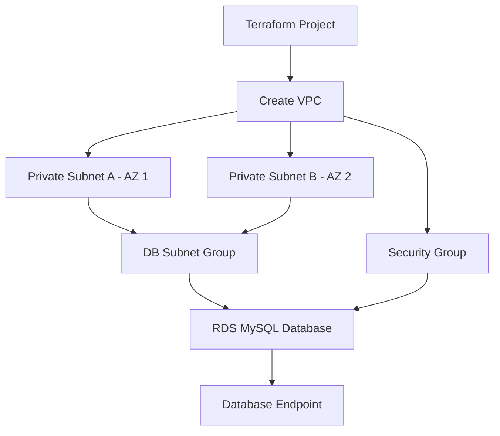
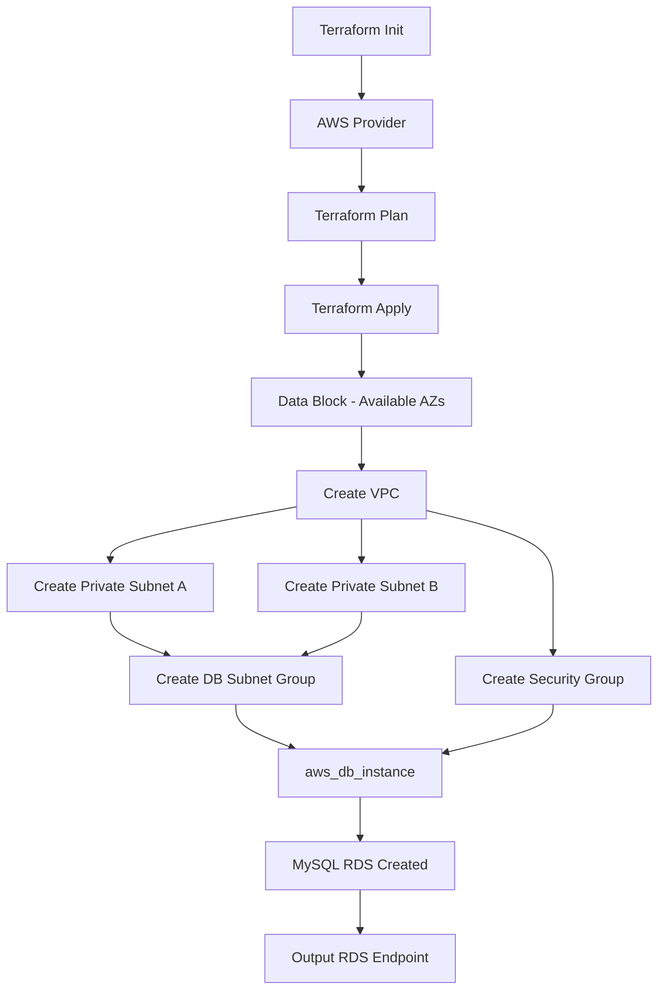
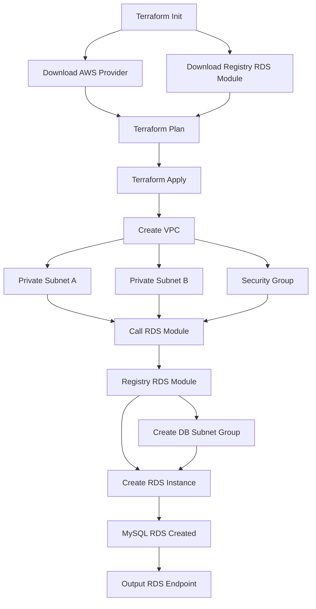
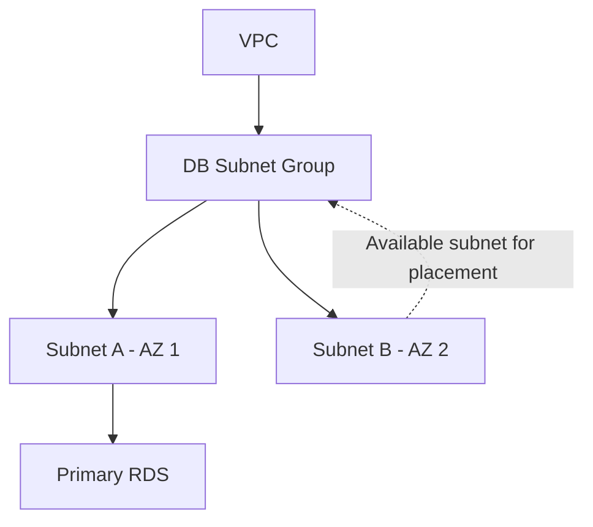
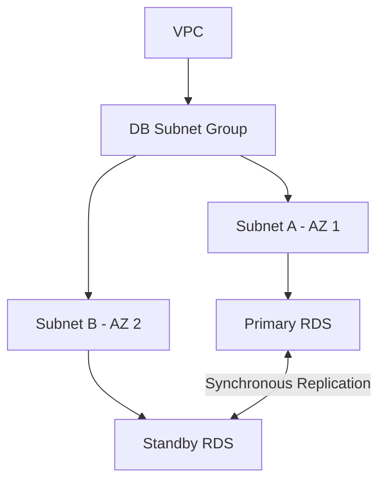
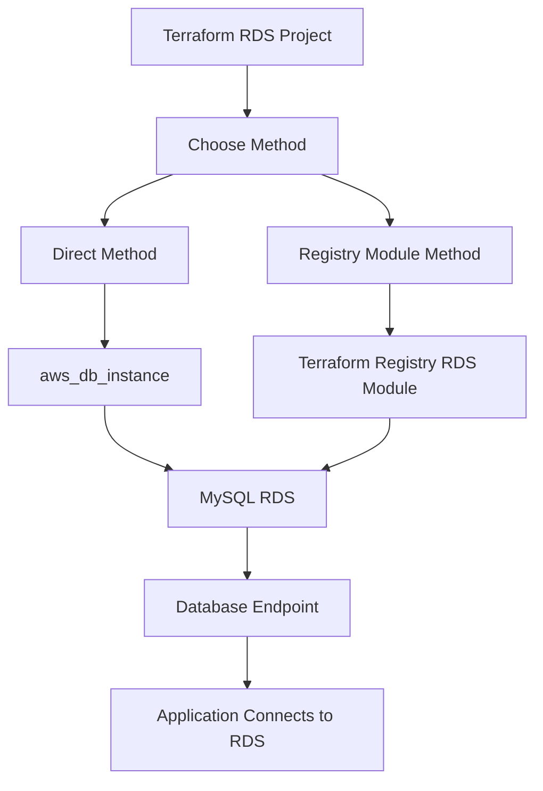

# Terraform RDS – Direct Method & Registry Module Method

## 1. Introduction

Terraform se AWS RDS MySQL Database create karne ke 2 methods hain:

1. **Direct Method** – AWS provider ke `aws_db_instance` resource ka use karke.
2. **Registry Module Method** – Terraform Registry ke pre-built RDS module ka use karke.

Dono methods mein hum VPC, 2 Private Subnets, DB Subnet Group aur Security Group configure karenge.

---

# 2. Common Network Architecture

Sabse pehle dono methods mein network create karenge.

### Flow Diagram



### Simple Explanation

| Step | Resource | Purpose |
|---|---|---|
| 1 | VPC | AWS ka private network |
| 2 | Subnet A | First Availability Zone |
| 3 | Subnet B | Second Availability Zone |
| 4 | DB Subnet Group | Dono subnets ko group karta hai |
| 5 | Security Group | Database traffic control karta hai |
| 6 | RDS | MySQL Database create karta hai |

**Important:** DB Subnet Group koi naya subnet nahi banata. Ye existing subnets ka group hota hai.

---

# 3. Method 1 – Direct RDS Creation

Direct method mein hum AWS provider ka `aws_db_instance` resource directly use karte hain.

### Direct RDS Flow Diagram



### Direct Method Code

**1. DB Subnet Group**

```hcl
resource "aws_db_subnet_group" "rds" {
  name = "rds-subnet-group"

  subnet_ids = [
    aws_subnet.private_a.id,
    aws_subnet.private_b.id
  ]
}
```

Yahan hum dono private subnet IDs ko DB Subnet Group mein pass kar rahe hain.

**2. RDS Instance**

```hcl
resource "aws_db_instance" "mysql" {
  identifier        = "direct-rds-mysql"
  engine            = "mysql"
  instance_class    = "db.t3.micro"
  allocated_storage = 20

  db_name  = var.db_name
  username = var.db_username
  password = var.db_password

  db_subnet_group_name = aws_db_subnet_group.rds.name

  vpc_security_group_ids = [
    aws_security_group.rds.id
  ]

  publicly_accessible = false
  skip_final_snapshot = true
}
```

### Code Explanation

- `aws_db_subnet_group` – Dono private subnets ko group karta hai.
- `aws_db_instance` – Actual RDS database create karta hai.
- `db_subnet_group_name` – RDS ke saath DB Subnet Group attach karta hai.
- `vpc_security_group_ids` – RDS ke saath Security Group attach karta hai.
- `db_name` – Database ka naam.
- `username` – Master username.
- `password` – Master password.

**Direct Method mein hum RDS resource ka configuration khud likhte hain.**

---

# 4. Method 2 – Registry Module se RDS Creation

Terraform Registry par already pre-built RDS module available hai.

Module source:

```hcl
module "rds" {
  source  = "terraform-aws-modules/rds/aws"
  version = "6.12.0"

  identifier = "registry-rds-mysql"

  engine         = "mysql"
  instance_class = "db.t3.micro"

  allocated_storage = 20

  db_name  = var.db_name
  username = var.db_username
  password = var.db_password
  port     = "3306"

  create_db_subnet_group = true

  subnet_ids = [
    aws_subnet.private_a.id,
    aws_subnet.private_b.id
  ]

  vpc_security_group_ids = [
    aws_security_group.rds.id
  ]

  publicly_accessible = false
  skip_final_snapshot = true
  deletion_protection = false
}
```

### Registry Module Flow Diagram



### Registry Module Explanation

| Argument | Meaning |
|---|---|
| `source` | Module ka source/location |
| `version` | Module version |
| `identifier` | RDS instance identifier |
| `engine` | Database engine |
| `instance_class` | RDS instance size |
| `allocated_storage` | Storage in GB |
| `db_name` | Database name |
| `username` | Master username |
| `password` | Master password |
| `subnet_ids` | Dono private subnet IDs |
| `vpc_security_group_ids` | Security Group ID |
| `create_db_subnet_group` | Module ko DB Subnet Group create karne ke liye enable karta hai |

**Registry Method mein hum pre-built module ko required inputs dete hain. Module internally RDS-related resources create karta hai.**

---

# 5. RDS Actually Kis Subnet Mein Rehta Hai?

Ye bahut important concept hai.

DB Subnet Group mein hum 2 subnets dete hain, lekin actual RDS placement deployment type par depend karta hai.

## A. Single-AZ Deployment



- DB Subnet Group mein dono subnets hain.
- Single-AZ deployment mein actual RDS ek AZ mein run karta hai.
- Doosre subnet mein automatically standby database create nahi hota.

## B. Multi-AZ Deployment



- Primary RDS ek Availability Zone mein hota hai.
- Standby RDS doosri Availability Zone mein hota hai.
- Primary normally Read/Write operations handle karta hai.
- Standby High Availability aur Automatic Failover ke liye hota hai.

### Important Difference

| Single-AZ | Multi-AZ |
|---|---|
| One AZ mein primary DB | Primary + standby in separate AZs |
| Standby DB nahi | Standby DB maintained |
| High availability ke liye Multi-AZ jaisa protection nahi | Automatic failover support |

**Important:** Sirf 2 subnets DB Subnet Group mein dene se Multi-AZ enable nahi hota.

Direct resource mein:

```hcl
multi_az = true
```

Registry module mein bhi supported input:

```hcl
multi_az = true
```

set karna hota hai.

---

# 6. variables.tf – Variable Declaration

```hcl
variable "db_name" {
  description = "RDS database name"
  type        = string
}

variable "db_username" {
  description = "RDS master username"
  type        = string
}

variable "db_password" {
  description = "RDS master password"
  type        = string
  sensitive   = true
}
```

### terraform.tfvars

```hcl
db_name     = "employee"
db_username = "admin"
db_password = "ReplaceWithYourStrongPassword"
```

| File | Purpose |
|---|---|
| `variables.tf` | Variables declare karta hai |
| `terraform.tfvars` | Actual values assign karta hai |
| `main.tf` | `var.db_name` etc. se values access karta hai |

**Note:** `sensitive = true` CLI output mein password hide karta hai, lekin Terraform state file mein password store ho sakta hai. State ko secure rakhna zaroori hai.

---

# 7. Direct vs Registry Module

| Direct Method | Registry Module |
|---|---|
| `aws_db_instance` use karte hain | `module` block use karte hain |
| RDS configuration khud likhte hain | Pre-built module reuse karte hain |
| More explicit resource configuration | Less repetitive code |
| AWS provider resource directly use hota hai | AWS provider + Registry module use hota hai |

---

# 8. Terraform Commands

Har method ke folder mein separately commands run karo:

```bash
terraform init
terraform fmt
terraform validate
terraform plan
terraform apply
```

Practice complete hone par:

```bash
terraform destroy
```

**Note:** Dono folders ka Terraform state alag hota hai. Dono methods ko separately execute karo.

---

# 9. .gitignore

Credentials aur generated files ko GitHub par push nahi karna:

```gitignore
**/.terraform/
*.tfstate
*.tfstate.*
**/terraform.tfvars
**/*.auto.tfvars
crash.log
crash.*.log
.terraformrc
terraform.rc
override.tf
override.tf.json
*_override.tf
*_override.tf.json
```

`.terraform.lock.hcl` ko normally Git mein commit karna recommended hai.

---

# 10. Interview-Ready Summary

**Direct Method:**

First, I create a VPC and two private subnets in different Availability Zones. Then I create a DB Subnet Group using both subnet IDs and create a Security Group. Finally, I create the RDS instance using the `aws_db_instance` resource and attach the DB Subnet Group and Security Group.

**Registry Module Method:**

First, I create the VPC, private subnets, and Security Group in my root configuration. Then I call the RDS module from Terraform Registry and pass the subnet IDs, Security Group ID, database name, username, and password as inputs. The module creates the RDS-related resources.

**RDS Subnet Concept:**

A DB Subnet Group contains multiple subnets in different Availability Zones. In Single-AZ deployment, the DB instance runs in one AZ. In Multi-AZ deployment, AWS maintains a standby in another AZ for high availability and automatic failover.

---

# 11. Final Concept Flow



**Remember:** Direct method mein hum RDS resource khud define karte hain. Registry method mein hum ready-made module reuse karte hain. Dono methods mein DB Subnet Group RDS ko multiple subnets provide karta hai; Multi-AZ enable karne par AWS doosri AZ mein standby maintain karta hai.