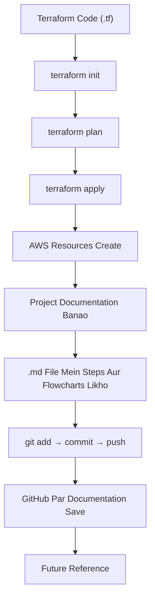

# Markdown (.md) – Short Notes

## 1. Markdown Kya Hai?

`.md` ka full form **Markdown** hai.

Ye ek lightweight markup language hai, jiska use project documentation, notes aur technical guides likhne ke liye hota hai.

**Simple Meaning:** `.md` file project ki information document karne ke liye use hoti hai.

## 2. Markdown Kyun Use Karte Hain?

- Project ke steps aur commands save karne ke liye.
- Resource dependencies explain karne ke liye.
- Tables aur flowcharts banane ke liye.
- Future reference ke liye.
- Documentation GitHub par maintain karne ke liye.

## 3. Complete Working Flow

## 4. Terraform vs Markdown

| File | Purpose |
|---|---|
| `.tf` | Infrastructure create/manage karna |
| `.md` | Project documentation maintain karna |
| `README.md` | Project overview |
| `dependency-flow.md` | Resource dependency explain karna |
| `destroy-flow.md` | Resource destroy flow explain karna |

## 5. Important Points

1. `.md` file AWS resources create nahi karti.
2. `terraform apply` sirf Terraform configuration apply karta hai, Markdown nahi.
3. GitHub Markdown files ko formatted documentation mein display karta hai.
4. Markdown mein headings, tables, code blocks aur Mermaid flowcharts bana sakte hain.

## 6. Interview Answer

Markdown is a lightweight markup language used to create project documentation, README files, technical notes, tables and diagrams.

**Remember:**
- `.tf` = Infrastructure ka code.
- `.md` = Infrastructure ki documentation.